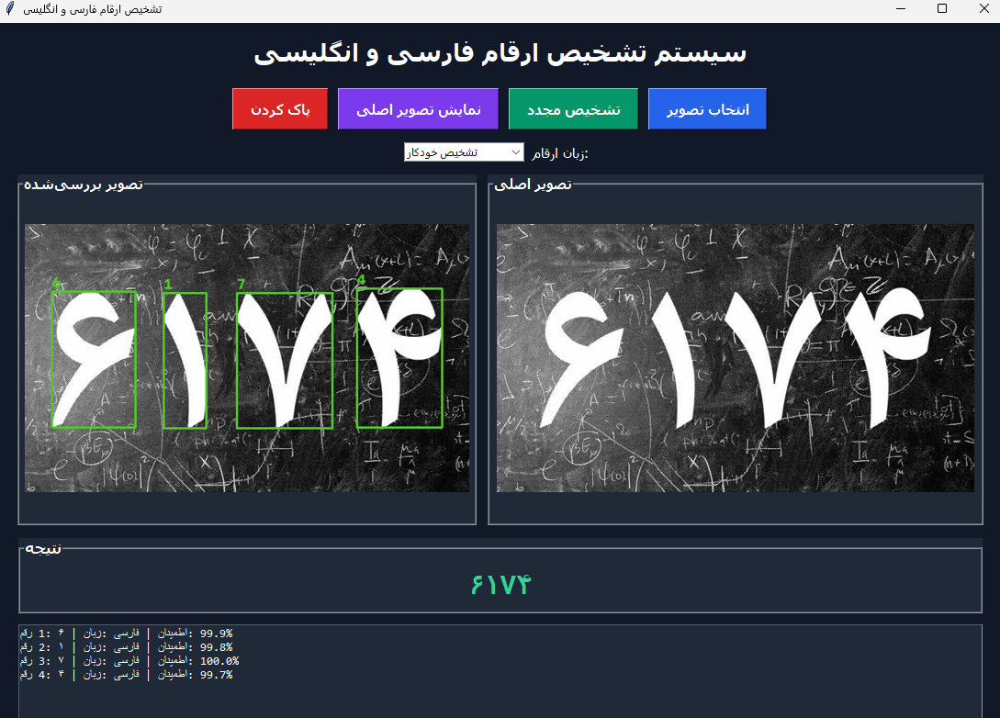
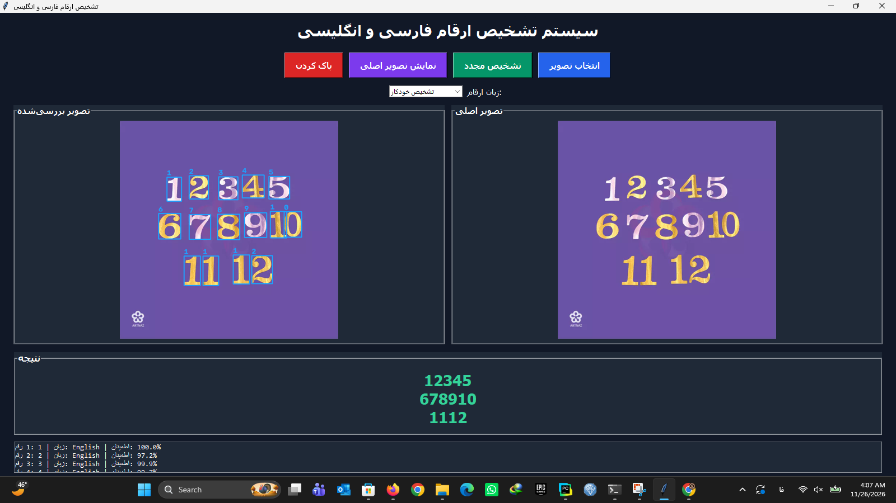

# DigitReader
### Persian and English Handwritten Digit Recognition System

DigitReader is a Python-based desktop application designed to recognize handwritten Persian and English digits from images using deep learning techniques.

The system provides automatic language detection, image preprocessing, digit segmentation, and confidence-based recognition through a graphical user interface.

## Features

- **Persian Digit Recognition:** Recognizes handwritten Persian digits (۰–۹).
- **English Digit Recognition:** Recognizes handwritten English digits (0–9).
- **Automatic Language Detection:** Automatically identifies the digit language.
- **Image Processing:** Preprocesses images and segments individual digits.
- **Confidence Score:** Provides prediction confidence for recognized digits.
- **Graphical User Interface:** User-friendly desktop application built with Tkinter.
- **Multiple Recognition Modes:** Automatic, Persian-only, and English-only recognition.

## Technologies

- Python
- PyTorch
- OpenCV
- NumPy
- Pillow
- Tkinter
- Convolutional Neural Networks (CNN)

## Project Structure

```text
DigitReader/
│
├── src/
│   ├── main.py
│   └── README.md
│
├── models/
│   ├── digit_model.pt
│   ├── digit_model_v2.pt
│   ├── english_digit_model.pt
│   ├── english_digit_model_v2.pt
│   └── lang_model_v2.pt
│
├── assets/
├── screenshots/
│
├── requirements.txt
├── README.md
├── .gitignore
└── LICENSE
```

## Installation

### 1. Clone the Repository

```bash
git clone https://github.com/masoumehmiirzaee/DigitReader.git
cd DigitReader
```

### 2. Create a Virtual Environment

```bash
python -m venv venv
```

Activate the environment:

**Windows:**

```bash
venv\Scripts\activate
```

**Linux / macOS:**

```bash
source venv/bin/activate
```

### 3. Install Dependencies

```bash
pip install -r requirements.txt
```

Required packages include:

- PyTorch
- NumPy
- OpenCV
- Pillow

### 4. Tkinter Requirement

DigitReader uses Tkinter for its graphical user interface.

Tkinter is included with most standard Python installations and does not need to be installed using pip.

**Windows:**

Make sure Tcl/Tk support is included in your Python installation.

To test Tkinter, run:

```bash
python -m tkinter
```

If a small graphical window opens, Tkinter is working correctly.

**Troubleshooting Tcl/Tk on Windows:**

If you encounter the error:

```text
_tkinter.TclError: Can't find a usable init.tcl
```

Check that the Tcl and Tk directories exist in your Python installation.

For a standard Python 3.13 installation, you can set the paths in CMD:

```cmd
set "TCL_LIBRARY=%LOCALAPPDATA%\Programs\Python\Python313\tcl\tcl8.6"
set "TK_LIBRARY=%LOCALAPPDATA%\Programs\Python\Python313\tcl\tk8.6"
```

If Python is installed in another location or version, adjust these paths accordingly.

Then test Tkinter again:

```cmd
python -m tkinter
```

**Linux:**

On Ubuntu or Debian-based distributions, install Tkinter using:

```bash
sudo apt install python3-tk
```

### 5. Prepare Model Files

Make sure the trained model files are placed inside the `models/` directory.

The application supports both the original models and the V2 models.

The language detection model is used when available.

## Running the Application

Run the following command from the project root directory:

```bash
python src/main.py
```

The graphical interface will open and allow you to select an image for digit recognition.

## How to Use

1. Launch the application.
2. Click **Select Image** to upload an image.
3. Choose the recognition mode:
   - Automatic Detection
   - Persian
   - English
4. View the recognized digits and confidence scores.
5. Inspect the processed image and detection results.

## Application Screenshots

Application screenshots are available in the `screenshots/` directory.

### Persian Digit Recognition



### English Digit Recognition



## Model Information

DigitReader uses separate deep learning models for Persian and English digit classification.

The V2 architecture also supports a 20-class language detection model, consisting of 10 Persian and 10 English digit classes.

## Recognition Performance

The automatic language detection feature is still experimental and may occasionally misclassify digits.

In current testing, automatic language detection achieved approximately 90% correct results. Performance may vary depending on image quality, handwriting style, and digit similarity.

For more reliable results, users can manually select Persian or English recognition mode.

## License

This project is licensed under the MIT License. See the [LICENSE](LICENSE) file for details.
